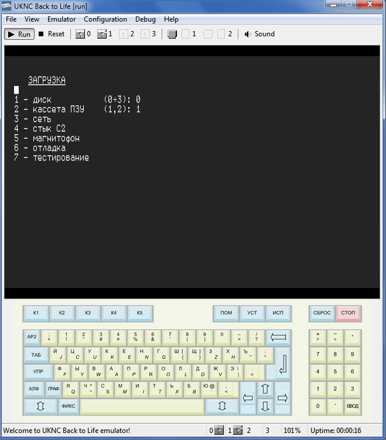

# ukncbtl
UKNCBTL — UKNC Back to Life! emulator, Windows x86-64 version.

### Building on Windows

Install Visual Studio 2026 with the Desktop development with C++ workload and a
Windows SDK. Use its bundled CMake (4.1 or newer for the Visual Studio 2026
generator), for example from a Visual Studio Developer PowerShell:

```powershell
cmake -S . -B build -G "Visual Studio 18 2026" -A x64
cmake --build build --config Release
```

The executable is `build/Release/UKNCBTL.exe`. Use `--config Debug` for a
debug build, or open the CMake project in Visual Studio.
The emulator requires the x64 target. CMake also supports older
installed Visual Studio generators; select the matching generator explicitly.
The build also produces `RenderVfw.dll` beside the executable; keep both files
together when distributing or moving the program. `cmake --install build
--config Release --prefix <destination>` installs both files. The default renderer
is included from the upstream renderer project under `third_party/RenderVfw`.
The ROM and other resources are embedded in the executable. This modern build
uses the current Microsoft toolchain and Windows SDK and does not target Windows
XP.

Run the CMake test suite after building the corresponding configuration:

```powershell
ctest --test-dir build -C Release --output-on-failure
```

The suite includes the existing core tests, exhaustive disassembly and hint
checks, and screenshot, WAV, and bitmap tests. Configure with
`-DBUILD_TESTING=OFF` to omit the test targets.

[](https://www.gnu.org/licenses/lgpl-3.0)
[](https://ci.appveyor.com/project/nzeemin/ukncbtl)
[](https://www.codefactor.io/repository/github/nzeemin/ukncbtl)





### Эмулятор UKNCBTL

UKNCBTL — UKNC Back to Life! — это эмулятор компьютера Электроника МС-0511 (УКНЦ).
УКНЦ это советский домашний/учебный компьютер, построенный на двух процессорах КМ1801ВМ2, совместимых по системе команд с Электроника-60, ДВК и др.

Текущее состояние эмулятора: в разработке. Большая часть программного обеспечения запускается и работает.

Эмулируются:
 * Центральный и периферийный процессоры
 * Оба контроллера памяти
 * Видеоконтроллер
 * Контроллер гибких дисков (стандарт MZ, 400/800 КБ на диск)
 * Картриджи ПЗУ (24 КБ на картридж)
 * Звук
 * Контроллер жёсткого диска IDE (два варианта)
 * Работа с кассетным магнитофоном — эмулируется через работу с WAV PCM файлами
 * Последовательный порт (Стык С2)
 * Параллельный порт — через запись вывода в файл, для просмотра результата можно использовать утилиту [ESCParser](https://github.com/nzeemin/escparser)

Пока что НЕ эмулируются: сетевая карта, RAM-диски, джойстики.

Огромное спасибо всем тем, кто внёс свой вклад в создание и развитие эмулятора, особенно:
 * Феликс Лазарев — проделал огромную работу на начальном этапе развития эмулятора
 * Алексей Кислый (Alex_K) — оказал неоценимую помощь во всех вопросах, касающихся деталей работы УКНЦ

-----

### In English
*UKNCBTL* is cross-platform UKNC emulator for Windows/Linux/Mac OS X.
*UKNC* (*УКНЦ*, Электроника МС-0511) is soviet school computer based on two PDP-11 compatible processors KM1801VM2.

Current status: under development. Most of software works fine.

Emulated:
 * CPU and PPU
 * Both memory controllers
 * Video controller
 * FDD controller (MZ standard, 400K/800K .dsk/.trd files)
 * ROM cartridges (24K .bin files)
 * Sound
 * Hard disk (IDE, .img files) — can read/write and boot
 * Tape cassette — read/write WAV PCM files
 * Serial port (experimental)
 * Parallel port — just dump output to file, use ESCParser to visualize the result

NOT emulated yet: network card, RAM disks, joysticks.

-----

The UKNCBTL project consists of:
* [ukncbtl](https://github.com/nzeemin/ukncbtl/) the Windows x86-64 version.
* [ukncbtl-renders](https://github.com/nzeemin/ukncbtl-renders/) — renderers for UKNCBTL Win32.
* [ukncbtl-qt](https://github.com/nzeemin/ukncbtl-qt/) is based on Qt framework and works under Windows, Linux and Mac OS X.
* [ukncbtl-testbench](https://github.com/nzeemin/ukncbtl-testbench/) — test bench for regression and performance testing.
* [ukncbtl-utils](https://github.com/nzeemin/ukncbtl-utils/) — various utilities: rt11dsk, sav2wav, ESCParser etc.
* [ukncbtl-doc](https://github.com/nzeemin/ukncbtl-doc/) — documentation and screenshots.
* [ukncbtl-wasm](https://github.com/nzeemin/ukncbtl-wasm/) — web version of the emulator.
* Project wiki: https://github.com/nzeemin/ukncbtl-doc/wiki
  * Screenshots: https://github.com/nzeemin/ukncbtl-doc/wiki/Screenshots-ru
  * User's Manual (in Russian): https://github.com/nzeemin/ukncbtl-doc/wiki/Users-Manual-ru
